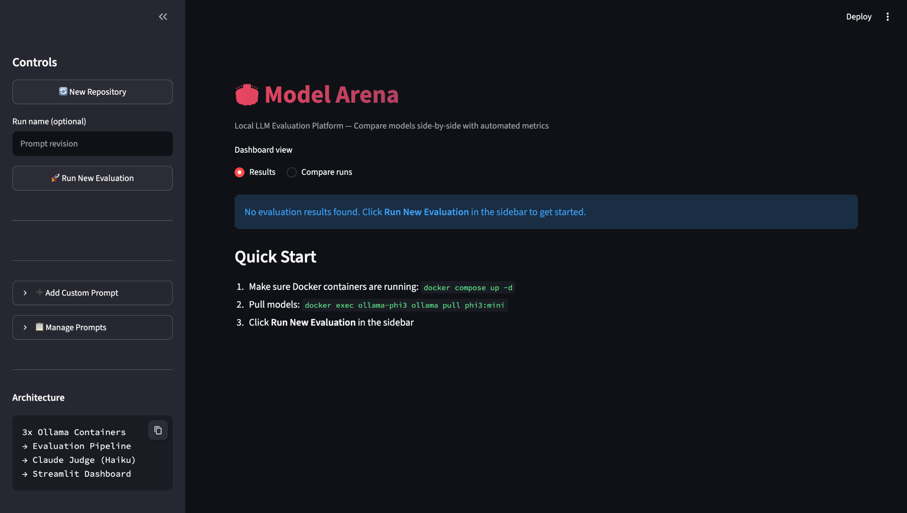

# Model Arena

**Find the best local LLM for your project** — paste a GitHub URL, and Model Arena analyzes your codebase, recommends models, downloads them into Docker containers, and runs tailored evaluations with automated scoring.

Built during a hackathon by Manik Sharma, Syed, Igor, and VinayaRekha.

---

## Dashboard Preview



*Updated dashboard with an optional run name, evaluation controls, and a selector for results or saved-run comparison.*

## Enhancements to the Original Project

The original Model Arena pipeline analyzes repositories, discovers local models, runs evaluations, and displays model scores. This extension adds a workflow for saving named experiments and comparing evaluation runs over time.

### Named Runs and Evaluation Metadata

- Give evaluations recognizable names, such as **Baseline** or **Prompt revision**.
- Save the actual filtered prompt set and a prompt fingerprint alongside each run.
- Record model names, judge model, available host details, evaluator Git commit, and generation-setting metadata.
- Keep the existing JSON result-list format, with additional metadata stored separately in `results/metadata/`.
- Generate unique filenames so evaluations saved close together do not overwrite one another.

### Baseline and Current Run Comparison

- Select two saved runs from the **Compare runs** view.
- Match responses by model name and prompt ID, then display baseline values, current values, and differences.
- Compare judge scores, keyword scores, overlap scores, generation speed, request latency, and memory samples.
- Capture model-loading, prompt-processing, and generation durations when Ollama supplies them.
- Review total attempts, failures, matched pairs, and the sample count used for each metric.
- Inspect baseline and current responses side by side with their judge explanations.

### Comparison Checks and Exports

- Show warnings when prompt sets, model/prompt coverage, judge models, or recorded run settings differ.
- Keep missing scores unavailable instead of replacing them with zeros; exclude failed responses from paired metric means while reporting their failures separately.
- Support older result files, with a warning when prompt metadata is unavailable.
- Export metric comparisons and coverage counts as CSV, or download a Markdown comparison report.

### Code Organization

| File | Responsibility |
| --- | --- |
| `evaluate.py` | Capture run metadata and timing fields; save named evaluations. |
| `dashboard.py` | Add run naming and the Results / Compare runs selector. |
| `arena/run_store.py` | Load and save results and metadata. |
| `arena/comparison.py` | Pair responses, calculate metric differences, and check comparison coverage. |
| `arena/reporting.py` | Generate CSV and Markdown exports. |
| `arena/comparison_ui.py` | Render run selection, comparison tables, response inspection, and downloads. |
| `tests/test_run_comparison.py` | Test storage, comparisons, missing values, failures, and exports. |
| `tests/test_evaluator_integration.py` | Test evaluator metadata and timing integration with simulated responses. |

### Using Run Comparison

1. Open the dashboard with `python -m streamlit run dashboard.py`.
2. Enter an optional name before starting an evaluation.
3. Save at least two evaluations, or use existing saved result files.
4. Select **Compare runs**, then choose a baseline and a current run.
5. Review the coverage and failure counts, inspect response changes, and export the comparison.

Comparisons use raw metric values rather than independently normalized leaderboard scores. A delta means **current minus baseline**. Paired means include only matching responses that succeeded in both runs and have both metric values available.

### Automated Tests

The extension includes **19 passing automated tests** covering result compatibility, metadata storage, prompt matching, missing scores, failed responses, duplicate IDs, exports, and evaluator integration.

Run them from the project root:

```bash
python3 -m unittest discover -s tests -v
```

---

## Inspiration

Developers building AI-powered features face a common problem: **which LLM should I use?** Cloud APIs are expensive, and choosing between dozens of open-source models is overwhelming. We wanted a tool where a developer could paste their GitHub repo URL, and within minutes get a data-driven comparison of the best local LLMs for their specific use case — running entirely on their own machine.

Model Arena combines Claude's code understanding with HuggingFace's model ecosystem and Ollama's local inference to create an end-to-end evaluation pipeline that's tailored to each project.

---

## How It Works

```
GitHub URL ──> Claude Haiku ──> HuggingFace ──> Docker/Ollama ──> Evaluation ──> Dashboard
               (analyze)        (find models)   (run locally)     (score)        (visualize)

```

### The Pipeline

**1. Repository Analysis** (`repo_analyzer.py`)

- Fetches your repo via GitHub REST API (README, source files, package manifests)
- Sends the code to **Claude Haiku** which determines:
  - What the project does
  - What LLM task would help (code-generation, summarization, Q&A, etc.)
  - Generates 5-8 evaluation prompts tailored to your actual codebase
- Example: A Flask REST API gets prompts about route handling and ORM queries; a React app gets component rendering prompts

**2. Model Discovery** (`model_discovery.py`)

- Queries **HuggingFace Hub API** for GGUF-compatible models matching the detected task
- Filters by size (fits in memory) and download count (community-validated)
- Falls back to curated lists of known-good Ollama models if HuggingFace search fails
- Returns 3 recommended models (e.g., `qwen2.5-coder:3b`, `codellama:7b`, `deepseek-coder:6.7b` for code tasks)

**3. Container Orchestration** (`container_manager.py`)

- Spins up 3 isolated **Docker containers** running Ollama, each on its own port
- Pulls the recommended models into each container with persistent volumes
- Resource-limited (8GB RAM, 4 CPUs per container) for fair comparison

**4. Evaluation Pipeline** (`evaluate.py`)

- Runs every generated prompt against all 3 models
- Measures per-response:
  - **Latency** (seconds) — `time.perf_counter()` around API call
  - **Tokens/sec** — from Ollama's `eval_count / eval_duration`
  - **Keyword accuracy** — fraction of expected keywords found in response
  - **BLEU-1 score** — unigram overlap with reference answer
  - **CPU %** and **Memory MB** — from `docker stats`
- Scoring methods: `keyword` (verifiable answers), `coherence_only` (creative/open-ended), `exact` (precise matches)
- Supports negated keywords (penalizes wrong answers)

**5. Claude-as-Judge** (`claude_judge.py`)

- Every response is also evaluated by **Claude Haiku** using rubric-based scoring
- Per-category rubrics with weighted criteria:
  - Coding: correctness (50%), syntax (30%), best practices (20%)
  - Reasoning: correctness (40%), logical validity (35%), step clarity (25%)
  - Creative: creativity (40%), coherence (30%), style (30%)
  - Summarization: key point coverage (40%), conciseness (30%), coherence (30%)
- Returns a 0-1 score with explanation and per-criterion breakdown

**6. Dashboard** (`dashboard.py`)

- **Streamlit + Plotly** interactive dashboard with:
  - Composite leaderboard (40% judge + 30% speed + 20% BLEU + 10% memory efficiency)
  - Speed comparison bar chart
  - Accuracy radar chart by category
  - Latency per prompt grouped bars
  - Resource usage (CPU/memory) comparison
  - Claude Judge score heatmap
  - Side-by-side response viewer with judge explanations

---

## Architecture

```
┌──────────────────────────────────────────────────────┐
│                   Streamlit Dashboard                 │
│  (Onboarding Flow → Charts → Leaderboard → Responses)│
└───────────────┬──────────────────────────┬────────────┘
                │                          │
    ┌───────────▼──────────┐   ┌───────────▼──────────┐
    │   repo_analyzer.py   │   │    evaluate.py        │
    │  (Claude Haiku API)  │   │  (Inference + Scoring)│
    └───────────┬──────────┘   └───────────┬───────────┘
                │                          │
    ┌───────────▼──────────┐   ┌───────────▼───────────┐
    │  model_discovery.py  │   │   claude_judge.py     │
    │  (HuggingFace API)   │   │  (Claude Haiku Judge) │
    └───────────┬──────────┘   └───────────────────────┘
                │
    ┌───────────▼──────────┐
    │ container_manager.py │
    └───────────┬──────────┘
                │
    ┌───────────▼────────────────────────────────┐
    │              Docker Desktop                 │
    │  ┌────────────┐ ┌────────────┐ ┌──────────┐│
    │  │ Ollama :0  │ │ Ollama :1  │ │Ollama :2 ││
    │  │ Port 11434 │ │ Port 11435 │ │Port 11436││
    │  │ Model A    │ │ Model B    │ │Model C   ││
    │  └────────────┘ └────────────┘ └──────────┘│
    └────────────────────────────────────────────┘

```

---

## Quick Start

### Prerequisites

- **Python 3.11+**
- **Docker Desktop** (with at least 24GB RAM allocated)
- **Anthropic API key** (for Claude Judge + repo analysis)

### Setup

```
# Clone the repo
git clone https://github.com/YOUR_USERNAME/model-arena.git
cd model-arena

# Install dependencies
pip3 install -r requirements.txt

# Set up environment variables
cp .env.example .env
# Edit .env and add your ANTHROPIC_API_KEY
```

### Run the Dashboard

```
streamlit run dashboard.py
```

1. Paste a GitHub repository URL (e.g., `https://github.com/pallets/flask`)
2. Click **Analyze Repository** — Claude analyzes the codebase and recommends models
3. Click **Proceed with these models** — Docker containers start and models download
4. Click **Run Evaluation on These Models** — evaluation runs with tailored prompts
5. View the leaderboard, charts, and side-by-side response comparisons

### Manual Mode (Static 3-Model Setup)

If you prefer the original static setup with phi3, llama3, and mistral:

```
# Start containers
docker compose up -d

# Pull models (run in parallel)
docker exec -d ollama-phi3 ollama pull phi3:mini
docker exec -d ollama-llama3 ollama pull llama3:8b
docker exec -d ollama-mistral ollama pull mistral:7b

# Run evaluation directly
python3 evaluate.py

# View results
streamlit run dashboard.py
# Click "Skip to Dashboard" on the landing page
```

---

## MCP Server Integration

Model Arena exposes its functionality as an **MCP (Model Context Protocol) server** for use with Claude Code or other MCP-compatible tools.

### Available Tools

| **Tool**                   | **Description**                                        |
| -------------------------- | ------------------------------------------------------ |
| `analyze_repo(github_url)` | Analyze a GitHub repo and get LLM task recommendations |
| `find_models(task, size)`  | Search HuggingFace for suitable models                 |
| `setup_arena(github_url)`  | Full pipeline: analyze → find → download → evaluate    |
| `run_evaluation(models)`   | Run evaluation on specified or all available models    |
| `list_prompts()`           | List all current evaluation prompts                    |
| `add_prompt(...)`          | Add a new evaluation prompt                            |
| `delete_prompt(id)`        | Remove a prompt                                        |
| `get_results(category)`    | Get results filtered by category                       |
| `compare_models(category)` | Get the composite-scored leaderboard                   |
| `judge_response(...)`      | Use Claude to judge a single response                  |

### Setup in Claude Code

The MCP server is configured in `.mcp.json`:

```
{
  "mcpServers": {
    "llm-evaluator": {
      "command": "python",
      "args": ["mcp_server.py"],
      "env": {
        "ANTHROPIC_API_KEY": "${ANTHROPIC_API_KEY}"
      }
    }
  }
}
```

---

## Project Structure

```
model-arena/
├── dashboard.py           # Streamlit dashboard (onboarding + visualization)
├── evaluate.py            # Evaluation pipeline (inference, scoring, metrics)
├── claude_judge.py        # Claude-as-Judge with per-category rubrics
├── repo_analyzer.py       # GitHub repo fetch + Claude analysis
├── model_discovery.py     # HuggingFace model search + fallback lists
├── container_manager.py   # Dynamic Docker container lifecycle
├── mcp_server.py          # FastMCP server exposing tools + resources
├── prompts.json           # Evaluation prompts (auto-generated or manual)
├── docker-compose.yml     # Static 3-model setup (fallback)
├── requirements.txt       # Python dependencies
├── .env.example           # Environment variable template
├── .mcp.json              # MCP server configuration
├── .gitignore             # Ignores .env, results/, __pycache__/
└── results/               # Evaluation results (JSON, timestamped)

```

---

## Scoring System

### Composite Score (with Claude Judge)

| **Weight** | **Metric**                             |
| ---------- | -------------------------------------- |
| 40%        | Claude Judge score (rubric-based, 0-1) |
| 30%        | Tokens per second (speed)              |
| 20%        | BLEU-1 score (reference similarity)    |
| 10%        | Memory efficiency (lower is better)    |

### Composite Score (without Claude Judge)

| **Weight** | **Metric**        |
| ---------- | ----------------- |
| 40%        | Keyword accuracy  |
| 30%        | Tokens per second |
| 20%        | BLEU-1 score      |
| 10%        | Memory efficiency |

---

## Configuration

### Environment Variables

| **Variable**        | **Required** | **Description**                             |
| ------------------- | ------------ | ------------------------------------------- |
| `ANTHROPIC_API_KEY` | Yes          | For Claude Judge and repo analysis          |
| `GITHUB_TOKEN`      | No           | For private repos or higher API rate limits |

### Docker Resources

Allocate at least **24GB RAM** to Docker Desktop:

- Docker Desktop → Settings → Resources → Memory → 24GB
- Each container gets up to 8GB with 4 CPU cores

---

## Tech Stack

- **Python 3.11+** — Core language
- **Streamlit** — Interactive web dashboard
- **Plotly** — Charts and visualizations
- **Docker + Ollama** — Local LLM inference containers
- **Anthropic Claude API** — Repo analysis and response judging
- **HuggingFace Hub** — Model discovery and search
- **FastMCP** — MCP server for Claude Code integration
- **Pandas** — Data processing and aggregation

## License

MIT